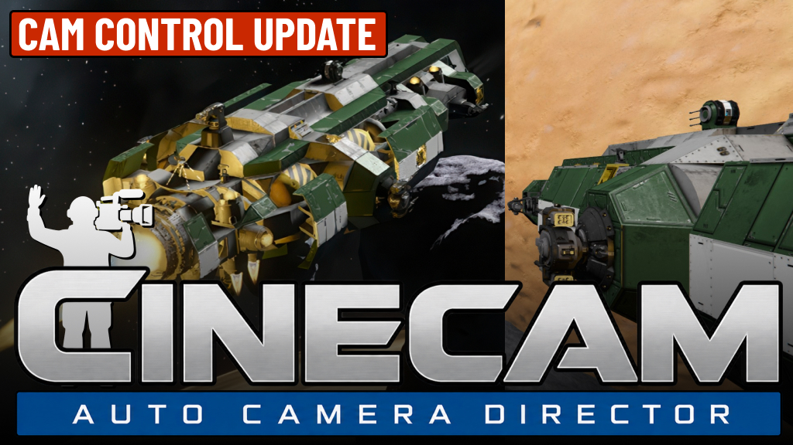
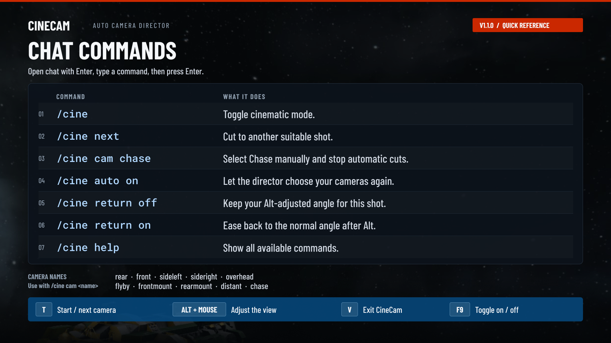

# CineCam — Automatic Camera Director

[](https://steamcommunity.com/sharedfiles/filedetails/?id=3802777032)
[](https://github.com/lutikri/SECinematicCamera)

**Version 1.1.0 — Camera Control Update**



Space Engineers has excellent ships, planets, and enormous empty spaces—but no automatic cinematic camera for simply enjoying a flight.

`SECinematicCamera` is a client-side Workshop mod that tries to fill that gap. It simulates a GTA-style cinematic camera: a virtual director watches the locally controlled ship or rover, chooses a suitable shot, places the camera ahead of time, follows the action, and cuts to a new angle when the current shot has run its course.

The goal is not another third-person camera glued to the center of the grid. Different shots have different rules: some lag behind the motion like a human camera operator, some are briefly mounted to the ship, and fly-bys stay fixed in the world while the ship passes through the frame.

## What's new in 1.1.0

- **Simpler controls:** T starts AUTO mode and cycles manual cameras once active. F9 toggles, Ctrl+F9 cycles, and V exits. B and Ctrl+B keep their vanilla behavior.
- **Mouse control:** hold Alt to orbit tracking cameras or pan/tilt either mounted camera. Smoothed motion uses a lower default sensitivity of `0.03` and respects the game's freelook binding and mouse settings.
- **Optional return:** `/cine return off` keeps the adjusted angle for the current shot; `/cine return on` restores the gentle return after releasing Alt.
- **View restoration:** normal exit restores the entry first/third-person mode and third-person zoom when the same cockpit is still controlled.
- **Smoother following:** continuous lead room, shared position/aim following, and gradual Chase heading changes reduce thrust-tap panning and abrupt reversal rotations.

## Demo

https://github.com/user-attachments/assets/0fdadb40-a6a4-40ee-b30c-bb1171c5eb69

## What it does

- Automatically selects the opening shot and later cuts using shot duration, recent shot history, speed, angular motion, and left/right continuity.
- Includes a trajectory-aware Chase shot that follows velocity during slides, uses spring lag, and expands with speed and acceleration.
- Supports low-sensitivity, smoothed Alt + mouse orbit in Chase, rear, front, side, and distant tracking shots, with an optional gentle return to the normal angle on release.
- Uses hard cuts between cameras—there is no artificial flight from one camera position to the next.
- Smooths position and aim on a shared follow rig *inside* a tracking shot, allowing the ship to move within the frame without an extra pan on every thrust tap. Lead room changes continuously through a stop/reversal; Chase filters motion and limits its heading response to 30 degrees per second.
- Keeps mounted shots short and rigid at their hull anchors, looks forward by default, and adds a subtle camera-local high-speed vibration. Alt + mouse smoothly pans/tilts the mounted camera itself; releasing Alt eases its aim back forward when camera return is enabled.
- Places fly-by cameras in world space and lets the ship pass them instead of attaching the camera to the grid; each fly-by is capped at five seconds.
- Uses natural gravity as camera Up on planets and the occupied cockpit/controller orientation in zero gravity.
- Keeps ordinary tracking shots inside safe screen margins while still allowing cinematic composition and lead room.
- Preserves ship controls while cinematic mode is active.
- Restores the first- or third-person view and third-person zoom used before activation when the same cockpit is still controlled; seat changes and world unload use a safe first-person fallback, and camera takeovers are respected.

The current shot set includes:

| Shot | Purpose |
| --- | --- |
| Rear High Three-Quarter | Safe chase view with the strongest acceleration response |
| Side High Left / Right | Elevated profile shots with continuity protection |
| Front High Three-Quarter | Forward-facing tracking shot |
| Overhead Drift | Short top-down establishing view |
| World-Locked Fly-By | Fixed camera that pans as the ship passes |
| Front Mounted Close | Short right-side body camera at the cockpit's longitudinal position |
| Rear Mounted Forward | Short rear-left corner camera looking forward along the cockpit axis |
| Distant Top-Side | Extremely wide, slow establishing view with heavy position and rotation inertia |
| Chase Rear / Offset | Spring-lag pursuit aligned to the vehicle's trajectory, with speed/acceleration distance and restrained roll |

## How the system works

1. **Target resolver** finds the locally occupied ship controller and its grid, including orientation, velocity, gravity, and oriented bounds.
2. **Cinematic director** evaluates the available profiles and selects a suitable shot. It avoids immediate repeats and visually similar successors rather than cycling through a fixed list.
3. **Shot solver** calculates an absolute world-space camera pose and a profile-specific point of interest. Each camera type can use its own composition and motion rules.
4. **Camera smoother** gives free tracking shots position and aim inertia. Soft and hard framing limits prevent that lag from losing the ship.
5. **Space Engineers adapter** takes exclusive control of `SpectatorFixed`, disables vanilla spectator movement, and writes the solved absolute pose every update.
6. **Safety controller** watches camera ownership and target validity. Every failure uses one idempotent emergency-stop path that restores the normal player camera when possible.

## Controls



| Input | Action |
| --- | --- |
| `T` | Enable automatic cinematic mode; while active, hard-cut to the next manual camera |
| `F9` | Toggle cinematic mode |
| `V` while cinematic is active | Exit and restore the saved first- or third-person ship view without leaving the cockpit |
| `Ctrl+F9` while cinematic is active | Cut to the next manual camera and disable automatic selection |
| Hold `Alt` + move mouse in a supported tracking shot | Orbit around the ship; release to ease back, or keep the angle with `/cine return off` |
| Hold `Alt` + move mouse in either mounted shot | Pan/tilt from the fixed hull mount; release to ease back forward, or keep the angle with `/cine return off` |
| `/cine` | Toggle cinematic mode |
| `/cine on` / `/cine off` | Explicitly enable or disable cinematic mode |
| `/cine next` | Force the director to choose another suitable shot |
| `/cine auto on` / `/cine auto off` | Enable or disable automatic shot changes |
| `/cine return on` / `/cine return off` | Enable smooth return after releasing Alt (default), or retain the adjusted angle for the current shot |

### Mouse control and return

Hold the native freelook binding (normally Alt) and move the mouse. Chase, rear, front, side, and distant tracking shots orbit around the ship. Both mounted shots pan/tilt in their own local frame while their positions stay attached to the hull. Fly-by and overhead shots keep their existing camera behavior. Mouse sensitivity and X/Y inversion follow the game's settings, with additional smoothing and a turn-speed limit.

Return is **ON by default**: release Alt to ease back to the shot's normal angle. Run `/cine return off` to keep your adjusted angle for the current shot. Run `/cine return on` to resume returning, including when an angle is already retained. Turning return OFF during a return keeps the current angle.

Automatic shot timing pauses while you adjust the view and during return, then resumes in AUTO mode. With return OFF, timing resumes once mouse motion settles. Camera changes remain hard cuts and reset the adjusted angle. Tracking elevation stays away from the pole; mounted pitch is limited to ±65 degrees. These angle limits do not add collision avoidance.

The return preference survives cinematic OFF/ON within the current session. `/cine reset` restores return ON; world reloads reset runtime settings.

### Manual camera selection

```text
/cine cam rear
/cine cam sideleft
/cine cam sideright
/cine cam front
/cine cam overhead
/cine cam flyby
/cine cam frontmount
/cine cam rearmount
/cine cam distant
/cine cam chase
/cine cam 1
```

### Runtime tuning

```text
/cine set duration 10
/cine set distance 0.75
/cine set height 1.2
/cine set side 1.1
/cine set smoothing 0.16
/cine set lookahead 0.05
/cine set orbitsensitivity 0.03
```

`distance` is relative to the vehicle size; `height` and `side` are ratios of that distance. Runtime tuning is not persisted yet. Use `/cine get` to view current values and `/cine reset` to restore the compiled defaults.

`orbitsensitivity` is an additional multiplier in degrees per mouse unit, adjustable from `0.005` to `0.5`; the default is `0.03`. Lower values make tracking orbit and mounted aiming less sensitive. `/cine get` also shows whether camera return is ON or OFF.

Other commands: `/cine status`, `/cine get`, `/cine reset`, `/cine debug on|off`, and `/cine help`. Handled `/cine` commands stay local and are not sent to chat or the server. Mod feedback uses temporary HUD notifications instead of chat messages.

Tap `T` to start in `AUTO`, tap `T` again to enter/cycle manual cameras, and press `V` to leave. Manual mode lasts only until cinematic mode is switched off. Every fresh `T`, `F9`, or `/cine on` activation starts in `AUTO` with a motion-weighted opening shot; consecutive activations do not reuse the same opening shot. Hotkeys are reserved only while controlling a valid ship or rover with building mode, chat, and menus closed. `V` is reserved while cinematic mode is active, preventing a second vanilla view toggle on exit. `Ctrl+F9` does nothing while cinematic mode is off; modified `T` is not a CineCam shortcut. `B` and `Ctrl+B` retain their vanilla behavior.

Normal exit restores the saved first/third-person mode and third-person zoom when the same entity is still controlled. A seat change never restores the old cockpit; the current controlled entity receives a safe first-person view if CineCam still owns the camera. If another system takes the camera, CineCam stops without reclaiming it. The normal `V` key can switch views again after exit.

## Installation for players

1. [Subscribe on Steam Workshop](https://steamcommunity.com/sharedfiles/filedetails/?id=3802777032).
2. Add **CineCam — Automatic Camera Director** to the world's mod list.
3. Load the world, occupy a ship or rover controller, and press `T` or `F9`.

To install a development build instead, build the project locally or copy a packaged mod into:

```text
%APPDATA%\SpaceEngineers\Mods\SECinematicCamera
```

The local development version appears in the mod list as `SECinematicCamera`. The repository includes `metadata.mod` and `thumb.jpg`, which are deployed with the mod.

## Building from source

### Prerequisites

- The current Steam version of Space Engineers.
- .NET SDK 9.0 or later.
- MDK2 with the `mdk2mod` template and packages.
- Git.
- Visual Studio 2022, Rider, VS Code, or the `dotnet` CLI.

Machine-specific Space Engineers paths belong in the ignored `mdk.local.ini`. Do not copy or commit game DLLs.

Build and deploy from the repository root:

```powershell
dotnet build .\SECinematicCamera.sln -c Release
```

MDK2 resolves references from the installed client, runs the ModAPI whitelist analyzer, compiles the mod, and deploys it locally with its version metadata and thumbnail. Keep the project `Version`, `metadata.mod` `ModVersion`, and the README release version in sync. On the development machine used to bootstrap this project, the resulting path is:

```text
C:\Users\artyo\AppData\Roaming\SpaceEngineers\Mods\SECinematicCamera
```

The verified Release build completes with **0 warnings and 0 errors**, including no MDK2 ModAPI whitelist analyzer diagnostics. No Space Engineers DLLs are stored in this repository.

## Architecture

```text
src/
  Session/    Lifecycle, update boundary, activation, and emergency shutdown
  Input/      Hotkeys and local chat commands
  Target/     Controlled-grid resolution, bounds, and framing anchors
  Director/   Shot profiles, suitability, history, continuity, and timing
  Camera/     Pose solving, composition, smoothing, shake, and SE camera adapter
  Safety/     Central safety checks and emergency-stop policy
  Config/     Compiled defaults and runtime tuning
  Debug/      Non-spammy local diagnostics
```

Space Engineers camera-controller and spectator access is deliberately isolated in `SECameraAdapter`. Shot changes are always hard cuts; smoothing is allowed only while following within one shot.

## Roadmap

### V0 — playable prototype

- [x] Safe cinematic-mode toggle and normal-camera restoration
- [x] Automatic director with history and shot suitability
- [x] Tracking, mounted, overhead, distant, and world-locked fly-by cameras
- [x] Per-shot following, aim smoothing, acceleration response, and shake
- [x] Manual camera selection and runtime tuning commands
- [x] Smoothed tracking orbit and mounted pan/tilt with configurable return
- [x] Gravity-relative planetary framing and cockpit-relative zero-G framing
- [x] MDK2 build, whitelist analysis, and local deployment
- [x] Steam Workshop release
- [ ] Continue tuning each camera independently for ships and rovers of very different sizes
- [ ] Improve director pacing and selection weights from longer playtests
- [ ] Complete in-game regression testing across first person, third person, seat changes, death, and world unload

### V1 — camera safety and configuration

- [ ] Camera collision and occlusion handling
- [ ] Persistent user presets and per-shot configuration
- [ ] Better support for unusual grids, subgrids, and offset cockpits
- [ ] Optional HUD/debug overlay for composition and director decisions

### Future experiments

- [ ] More contextual shots for braking, landing, turning, and high-speed cruising
- [ ] Multi-target framing for nearby ships or points of interest
- [ ] User-defined camera anchors or tagged camera blocks
- [ ] Shareable cinematic presets

Roadmap items are intentions, not promises; Space Engineers ModAPI limitations may change their final design.

## Current limitations

- There is no camera collision or occlusion solver yet. Cameras can clip into terrain, large structures, or other grids.
- Only the locally controlled ship or rover grid is supported.
- Runtime tuning is reset when the session reloads.
- Camera placement still needs profile-specific tuning for extremely small or very large grids.
- In-game validation is required after Space Engineers client updates.

For structured testing, see the [in-game checklist](docs/INGAME_TEST_CHECKLIST.md). The installed-client API investigation is documented in [camera collision research](docs/CAMERA_COLLISION_RESEARCH.md).

Paste-ready release history is available in [Workshop change notes](docs/WORKSHOP_CHANGE_NOTES.txt).
