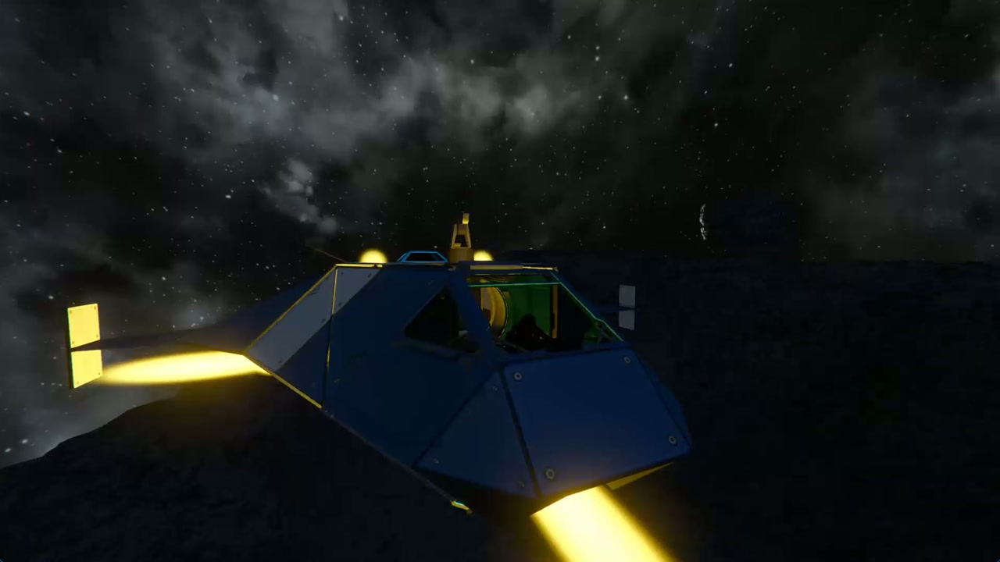

# SECinematicCamera

Space Engineers has excellent ships, planets, and enormous empty spaces—but no automatic cinematic camera for simply enjoying a flight.

`SECinematicCamera` is a client-side Workshop mod that tries to fill that gap. It simulates a GTA-style cinematic camera: a virtual director watches the locally controlled ship or rover, chooses a suitable shot, places the camera ahead of time, follows the action, and cuts to a new angle when the current shot has run its course.

The goal is not another third-person camera glued to the center of the grid. Different shots have different rules: some lag behind the motion like a human camera operator, some are briefly mounted to the ship, and fly-bys stay fixed in the world while the ship passes through the frame.

## Demo

[](docs/media/secinematic-camera-demo.mp4)

Click the image to open the 27-second MP4 demo.

## What it does

- Automatically selects shots using shot duration, recent shot history, speed, angular motion, and left/right continuity.
- Uses hard cuts between cameras—there is no artificial flight from one camera position to the next.
- Smooths position and aim *inside* a tracking shot, allowing the ship to move naturally within the frame during acceleration and rotation.
- Keeps mounted shots short and rigid, with a subtle high-speed vibration.
- Places fly-by cameras in world space and lets the ship pass them instead of attaching the camera to the grid.
- Uses natural gravity as camera Up on planets and the occupied cockpit/controller orientation in zero gravity.
- Keeps ordinary tracking shots inside safe screen margins while still allowing cinematic composition and lead room.
- Preserves ship controls while cinematic mode is active.
- Restores the original cockpit/third-person camera safely when cinematic mode ends.

The current shot set includes:

| Shot | Purpose |
| --- | --- |
| Rear High Three-Quarter | Safe chase view with the strongest acceleration response |
| Side High Left / Right | Elevated profile shots with continuity protection |
| Front High Three-Quarter | Forward-facing tracking shot |
| Overhead Drift | Short top-down establishing view |
| World-Locked Fly-By | Fixed camera that pans as the ship passes |
| Front Mounted Close | Short action-camera view near the front of the ship |
| Rear Mounted Forward | Short rear-mounted view looking along the ship |
| Distant Top-Side | Long, slow establishing view that emphasizes the surrounding world |

## How the system works

1. **Target resolver** finds the locally occupied ship controller and its grid, including orientation, velocity, gravity, and oriented bounds.
2. **Cinematic director** evaluates the available profiles and selects a suitable shot. It avoids immediate repeats and visually similar successors rather than cycling through a fixed list.
3. **Shot solver** calculates an absolute world-space camera pose and a profile-specific point of interest. Each camera type can use its own composition and motion rules.
4. **Camera smoother** gives free tracking shots position and aim inertia. Soft and hard framing limits prevent that lag from losing the ship.
5. **Space Engineers adapter** takes exclusive control of `SpectatorFixed`, disables vanilla spectator movement, and writes the solved absolute pose every update.
6. **Safety controller** watches camera ownership and target validity. Every failure uses one idempotent emergency-stop path that restores the normal player camera when possible.

## Controls

| Input | Action |
| --- | --- |
| `F9` | Toggle cinematic mode |
| `V` while cinematic is active | Exit cinematic mode and return to the normal ship camera |
| `Ctrl+F9` | Cut to the next manual test camera and disable automatic selection |
| `/cine` | Toggle cinematic mode |
| `/cine on` / `/cine off` | Explicitly enable or disable cinematic mode |
| `/cine next` | Force the director to choose another suitable shot |
| `/cine auto on` / `/cine auto off` | Enable or disable automatic shot changes |

Manual camera selection:

```text
/cine cam rear
/cine cam sideleft
/cine cam sideright
/cine cam front
/cine cam overhead
/cine cam flyby
/cine cam frontmount
/cine cam rearmount
/cine cam distant
/cine cam 1
```

Runtime tuning:

```text
/cine set duration 10
/cine set distance 0.75
/cine set height 1.2
/cine set side 1.1
/cine set smoothing 0.16
/cine set lookahead 0.05
```

`distance` is relative to the vehicle size; `height` and `side` are ratios of that distance. Runtime tuning is not persisted yet. Use `/cine get` to view current values and `/cine reset` to restore the compiled defaults.

Other commands: `/cine status`, `/cine get`, `/cine reset`, `/cine debug on|off`, and `/cine help`. Handled `/cine` commands stay local and are not sent to chat or the server.

## Installation for players

Until a Workshop release is available, build the project locally or copy a packaged mod into:

```text
%APPDATA%\SpaceEngineers\Mods\SECinematicCamera
```

Enable `SECinematicCamera` in the world's mod list, load the world, occupy a ship or rover controller, and press `F9`.

## Building from source

### Prerequisites

- The current Steam version of Space Engineers.
- .NET SDK 9.0 or later.
- MDK2 with the `mdk2mod` template and packages.
- Git.
- Visual Studio 2022, Rider, VS Code, or the `dotnet` CLI.

Machine-specific Space Engineers paths belong in the ignored `mdk.local.ini`. Do not copy or commit game DLLs.

Build and deploy from the repository root:

```powershell
dotnet build .\SECinematicCamera.sln -c Release
```

MDK2 resolves references from the installed client, runs the ModAPI whitelist analyzer, compiles the mod, and deploys it locally. On the development machine used to bootstrap this project, the resulting path is:

```text
C:\Users\artyo\AppData\Roaming\SpaceEngineers\Mods\SECinematicCamera
```

The verified Release build completes with **0 warnings and 0 errors**, including no MDK2 ModAPI whitelist analyzer diagnostics. No Space Engineers DLLs are stored in this repository.

## Architecture

```text
src/
  Session/    Lifecycle, update boundary, activation, and emergency shutdown
  Input/      Hotkeys and local chat commands
  Target/     Controlled-grid resolution, bounds, and framing anchors
  Director/   Shot profiles, suitability, history, continuity, and timing
  Camera/     Pose solving, composition, smoothing, shake, and SE camera adapter
  Safety/     Central safety checks and emergency-stop policy
  Config/     Compiled defaults and runtime tuning
  Debug/      Non-spammy local diagnostics
```

Space Engineers camera-controller and spectator access is deliberately isolated in `SECameraAdapter`. Shot changes are always hard cuts; smoothing is allowed only while following within one shot.

## Roadmap

### V0 — playable prototype

- [x] Safe cinematic-mode toggle and normal-camera restoration
- [x] Automatic director with history and shot suitability
- [x] Tracking, mounted, overhead, distant, and world-locked fly-by cameras
- [x] Per-shot following, aim smoothing, acceleration response, and shake
- [x] Manual camera selection and runtime tuning commands
- [x] Gravity-relative planetary framing and cockpit-relative zero-G framing
- [x] MDK2 build, whitelist analysis, and local deployment
- [ ] Continue tuning each camera independently for ships and rovers of very different sizes
- [ ] Improve director pacing and selection weights from longer playtests
- [ ] Complete in-game regression testing across first person, third person, seat changes, death, and world unload

### V1 — camera safety and configuration

- [ ] Camera collision and occlusion handling
- [ ] Persistent user presets and per-shot configuration
- [ ] Better support for unusual grids, subgrids, and offset cockpits
- [ ] Optional HUD/debug overlay for composition and director decisions

### Future experiments

- [ ] More contextual shots for braking, landing, turning, and high-speed cruising
- [ ] Multi-target framing for nearby ships or points of interest
- [ ] User-defined camera anchors or tagged camera blocks
- [ ] Shareable cinematic presets

Roadmap items are intentions, not promises; Space Engineers ModAPI limitations may change their final design.

## Current limitations

- There is no camera collision or occlusion solver yet. Cameras can clip into terrain, large structures, or other grids.
- Only the locally controlled ship or rover grid is supported.
- Runtime tuning is reset when the session reloads.
- Camera placement still needs profile-specific tuning for extremely small or very large grids.
- In-game validation is required after Space Engineers client updates.

For structured testing, see the [in-game checklist](docs/INGAME_TEST_CHECKLIST.md). The installed-client API investigation is documented in [camera collision research](docs/CAMERA_COLLISION_RESEARCH.md).
